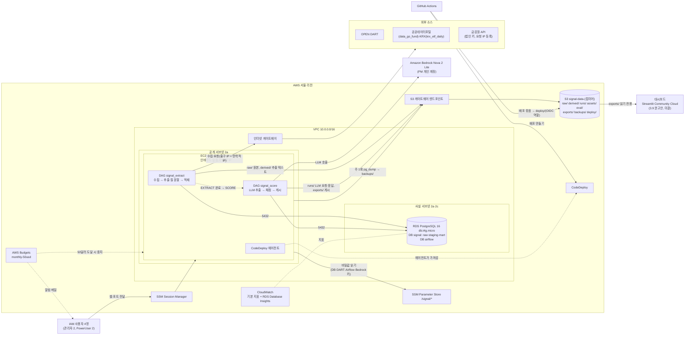

# AWS 저장 계층 설계

## 상태

| 항목 | 내용 |
|---|---|
| 상태 | 초안. 10차 미팅 안건. 10월 6일 단가 확인 반영. 10월 9일 일정 변경과 PR #43 변경 반영. 10월 11일 데이터 엔지니어링·인프라(주영) 리뷰 반영(PDF 도구 pdfplumber 전환, 메모리 합격 기준, Airflow 2.x 지원 종료, 파서 버전 형식). 10월 18일 리뷰 반영(arm64 확인 결과, Airflow·팀 코드 가상환경 분리, PDF 평균 크기 500건 실측) |
| 기준일 | 10월 4일(단가 10월 6일) |
| 담당 | PM(대현) |
| 리뷰 | 데이터 엔지니어링·인프라(주영) |
| 입력 | 9월 30일 저장 계층 계획서 초안, 10월 4일 PM 확인 결과, ERD v2.2(signal-pipeline 저장소 dev 브랜치, PR #43 병합본) |
| 다음 단계 | 구축은 AWS CLI 스크립트(`scripts/aws/`)로 하고 Terraform은 백업용으로 둠(10월 31일 12차 미팅 결정). 스크립트 작성·AWS 생성은 데이터 엔지니어링·인프라(주영)(11월 8일). 스크립트에 넣은 값은 6절과 각 절의 「구축 값」 |

- 가격은 10월 6일 AWS 가격 페이지의 서울 리전 공식 가격 데이터로 확인함(2절 「가격」). 무료 요금제 인스턴스 제한만 2차 출처 「추정」으로 남음
- 10월 4일 초안에서 「미확인」이던 요금(EBS 볼륨, RDS 저장 공간, 백업 저장 공간, 데이터 전송)은 단가와 용량 가정을 넣어 비용 표 합계에 포함함

## 1. 요약

- 권고 구성
  - 서울 리전 VPC 하나에 EC2 t4g.small 1대를 상시 실행. 이 서버에서 Airflow(LocalExecutor), PDF 텍스트 추출(pdfplumber), curl 수집을 모두 실행
  - EC2에 탄력적 IP 1개를 붙여 금감원 법인 키의 요청 IP로 등록. NAT 게이트웨이는 두지 않음
  - DB는 RDS PostgreSQL db.t4g.micro 단일 AZ. 사설 서브넷에 두고 EC2에서만 접속. Airflow 메타데이터 DB도 같은 인스턴스의 별도 데이터베이스로 둠
  - 원문은 S3 버킷 하나에 `raw/`, `derived/`, `runs/`, `assets/`, `eval/`, `exports/`, `backups/` 접두어로 저장. 경로는 원본 보관 규칙 문서의 `RAW_ROOT` 상대경로를 그대로 객체 키로 씀. 버전 관리와 덮어쓰기 금지 정책으로 원본 불변을 보장
  - ERD v2.2 표 17개를 PostgreSQL 스키마 `raw`(5개), `staging`(9개), `mart`(3개)에 배치
- 월 비용(추정): 권고안 약 42.71달러(EBS·RDS 저장·백업 포함), 최소안(EC2 1대에 PostgreSQL 포함, 하루 4시간만 실행) 약 10.98달러
- 10월 15일~12월 31일 누적(추정): 권고안 약 109.43달러. 크레딧 200달러를 다 받으면 범위 안, 가입 크레딧 100달러만 있으면 12월 하순(25일경)에 소진
- 월 상한 50달러(10월 4일 확정, 운영 목표이며 보장된 상한은 아님. 3.10). 단가 확인 결과 권고안이 50달러 안이므로 권고안을 기본 구성으로 둠(10월 6일)
- 크레딧 소진은 무료 요금제 종료와 계정 폐쇄로 이어지므로, 결제 주체 PM(대현)이 크레딧 잔액 40달러 이하가 되기 전에 유료 요금제로 전환

## 2. 확정 조건과 입력 수치

### 확정 조건

| 조건 | 내용 | 확정일 |
|---|---|---|
| CSP | AWS 서울 리전(ap-northeast-2) | 9월 30일 |
| 비용 | 비용 지원 없음. 상시 서버를 최소로 둠 | 9월 30일 |
| 오케스트레이션 | Airflow 사용 | 9월 2일 |
| 결제 주체 | PM(대현). 크레딧 소진 뒤 유료 전환과 결제도 PM 계정 | 10월 4일 |
| 월 상한 | 50달러. AWS Budgets 알림 25·40·50달러 3단계 | 10월 4일 |
| 프로젝트 종료 | 2026년 12월 | - |

### 데이터 규모

| 항목 | 값 | 근거 |
|---|---|---|
| DART 투자설명서 PDF 평균 크기 | 1.62MB | 크롤러 1차 500건 실측. 10월 4일 9건 실측은 1.07MB |
| DART 대상 건수 | 약 6,500건 | 추정. 9월 30일 저장 계층 계획서 기준 |
| DART 원본 합계 | 약 10.5GB | 위 두 값의 곱 |
| 추출 텍스트 합계 | 약 1.9GB | 10월 11일 PM 실측: DART 501건 pdfplumber(signal-pipeline PR #51, `pdfplumber-0.11_prep-4`) 결과 평균 `text.txt` 271KB + `structure.json` 28KB × 약 6,500건. 10월 4일 pdftotext 9건 기준 추정은 1.6GB |
| 금투협 원본 | 연 약 250GB | 추정, 미측정. 9월 23일 ERD v2 검토의 cloud 관점 추정([2단계 데이터 파이프라인 Flow 설계 입력](https://github.com/BOAZ-Signal-Team-26/signal-pipeline/blob/dev/docs/pipeline-flow.md) 「cloud 관점」). Phase 1 포함 여부 미정(결정 대기 D: 금투협 자료를 Phase 1 수집 범위에 넣을지에 대한 팀 결정) |
| 전량 재실행 1회 DB 행 수 | 약 8M행, 5~10GB | 추정, ERD v2.1 기준 산정([2단계 데이터 파이프라인 Flow 설계 입력](https://github.com/BOAZ-Signal-Team-26/signal-pipeline/blob/dev/docs/pipeline-flow.md) 「cloud 관점」) |

### AWS 계정 조건

- 신규 계정 크레딧: 가입 시 100달러 + 활동 5개 수행 시 최대 100달러, 합계 최대 200달러
- 무료 요금제는 가입 6개월 경과 또는 크레딧 소진 중 먼저 오는 시점에 종료
  - 종료 시 유료 요금제로 전환하지 않으면 계정이 자동 폐쇄되고 90일 뒤 삭제됨. S3 원문, RDS, 탄력적 IP 모두 함께 사라짐
  - 유료로 전환하면 계정과 자원이 유지됨
- 무료 요금제 인스턴스 제한(추정, 2차 출처): t3.small·t4g.small까지 사용 가능, t3.medium 불가

### 가격

서울 리전(ap-northeast-2) 온디맨드. 「공식」은 10월 6일 AWS 가격 페이지가 읽는 서울 리전 가격 데이터에서 확인한 값. 용량 가정은 이 문서의 수치이며 구축 뒤 실측으로 바꿈.

| 항목 | 단가 | 월 환산(730시간 또는 가정 용량) | 출처 |
|---|---|---|---|
| 공인 IPv4(탄력적 IP 포함) | 0.005달러/시간 | 3.65달러 | 공식 |
| EC2 t4g.small | 0.0208달러/시간 | 15.18달러 | 공식 |
| EC2 t3.small | 0.026달러/시간 | 18.98달러 | 공식 |
| EC2 t3.medium | 0.052달러/시간 | 37.96달러 | 공식 |
| RDS db.t4g.micro 단일 AZ | 0.025달러/시간 | 18.25달러 | 공식 |
| RDS 저장 공간 gp3 단일 AZ | 0.131달러/GB월 | 최소 할당 20GB 기준 2.62달러 | 공식 |
| RDS 자동 백업 저장 | 할당 저장 공간의 100%까지 무료, 초과분 0.095달러/GB월 | 0달러(7일 보관이 20GB 안) | 공식 |
| EBS gp3(EC2 루트) | 0.0912달러/GB월(3,000 IOPS·125MB/s 포함) | 20GB 기준 1.82달러. DB 데이터까지 두는 단일 EC2 구성은 40GB 기준 3.65달러 | 공식 |
| EBS gp2 | 0.114달러/GB월 | 쓰지 않음(gp3가 더 쌈) | 공식 |
| S3 Standard | 0.025달러/GB월 | DART 12.4GB(원본 10.5GB + 추출 텍스트 1.9GB) 기준 0.31달러 | 공식 |
| S3 Standard-IA | 0.0138달러/GB월, 꺼내 읽을 때 0.01달러/GB | 스냅숏 이동분. 12월까지 1달러 미만 | 공식 |
| S3 `backups/` 덤프 | S3 Standard 단가 | 주 1회 덤프 약 1GB(추정) × 35일 보관 ≈ 5개, 가정 35GB 상한 기준 0.88달러 | 공식 단가, 용량 추정 |
| 데이터 전송(인터넷 송신) | 전 리전 합산 월 100GB 무료, 초과분 0.126달러/GB(10TB까지) | 0달러. 4인 열람·대시보드 내보내기는 월 100GB 안. 수집(수신)은 무료 | 공식 |
| NAT 게이트웨이 | 약 0.059달러/시간 | 43.07달러 | 추정. 쓰지 않음. 처리 데이터 요금 별도 |
| Amazon MWAA 환경 Small | 0.5636달러/시간 | 411.43달러 | 공식. 쓰지 않음 |
| Parameter Store 표준 등급 | 무료(매개변수·표준 처리량 API) | 0달러 | 공식 |

### 9월 30일 계획서의 결정 항목과 이 문서의 절

| 결정 항목 | 절 |
|---|---|
| CSP·호스팅 | 2(확정 조건), 3.3 |
| DB 제품 | 3.1 |
| 원문 저장소 | 3.2 |
| 3계층 정의와 ERD 표 대응 | 3.6 |
| Airflow 실행 위치 | 3.3 |
| 백업 범위 | 3.7 |
| 고정 IP 확보(추가) | 3.4 |
| PDF 처리(pdfplumber)·수집(curl) 실행 위치(추가) | 3.5 |

## 3. 결정 항목

### 3.1 DB 제품과 위치

| 선택지 | 월 비용(추정) | 운영 부담 | 위험 |
|---|---|---|---|
| A. RDS PostgreSQL db.t4g.micro, 단일 AZ | 18.25달러 + 저장 공간 20GB 2.62달러 | 낮음. 자동 백업·패치·시점 복구를 AWS가 처리 | 메모리가 작아 큰 조인·정렬이 느릴 수 있음. 무료 요금제에서 사용 가능한지 공식 확인 필요 |
| B. EC2 안 Docker PostgreSQL | 0달러(EC2 비용에 포함) | 높음. 백업 스크립트·업그레이드·디스크 관리를 직접 함 | t4g.small 메모리 2GB를 Airflow·PDF 추출과 나눠 써서 메모리 부족 시 DB까지 함께 멈춤. EC2를 끄면 대시보드도 DB를 못 읽음 |
| C. RDS Multi-AZ | 단일 AZ의 약 2배(추정) | 낮음 | 비용 대비 이득 없음. 12월 종료 프로젝트에 가용성 요구가 없음 |

권고: A

- 근거
  - 이 프로젝트의 DB 위험은 가용성보다 데이터 유실이다. RDS 자동 백업이 이 위험을 직접 줄이고, B는 같은 수준을 맞추려면 백업 스크립트를 따로 만들어야 함
  - DB를 EC2와 분리하면 EC2를 켜고 끌 수 있음(3.3). 대시보드가 DB를 읽는 경우 DB만 켜 두면 됨
  - 전량 재실행 1회 5~10GB(추정)는 db.t4g.micro로 처리 가능한 규모. 느리면 인스턴스 크기만 올림
- 설정
  - PostgreSQL 16(마이너 16.15) 고정, 마이너 버전 자동 업그레이드 끔(11월 8일). 근거: DDL(signal-pipeline `db/migrations/V1__erd_v2_2.sql`)과 물리 결정 6건이 16 기준으로 검증됨. Airflow 2.11.2가 테스트한 PostgreSQL은 13~17이라 18은 제외(Airflow 공식 문서 Prerequisites). 17은 DDL 미검증. 16.15 표준 지원은 2027년 9월, 주 버전 16 표준 지원은 2029년 2월 28일까지(RDS PostgreSQL 출시 일정)로 프로젝트 기간보다 김. 11월 8일 계정의 RDS 기본 주 버전은 18
  - 공개 접근 끔(publicly accessible = false). 사설 서브넷 2개(ap-northeast-2a, 2c)로 DB 서브넷 그룹 구성(RDS 필수 조건)
  - 데이터베이스 2개: `signal`(ERD 표), `airflow`(Airflow 메타데이터)
  - 저장 공간 gp3 20GB로 시작하고 자동 확장 상한 50GB(월 최대 6.55달러). 전량 재실행 1회 5~10GB(추정)의 두세 배
- 구축 값(11월 8일 결정, `scripts/aws/03-rds.sh`)
  - 식별자 `signal-db`, db.t4g.micro, 단일 AZ(2a, EC2와 같은 가용 영역), DB 서브넷 그룹 `signal-db-subnets`(사설 2a·2c), 파라미터 그룹 `signal-pg16`(`postgres16` 계열, 값은 기본값: `rds.force_ssl` 1, `timezone` UTC)
  - 마스터 사용자 `signal_admin`, 비밀번호는 SSM `/signal/rds/master_password`. RDS 관리형 비밀번호는 Secrets Manager 요금이 붙어 쓰지 않음(3.8)
  - 자동 백업 7일, 백업 시간대 18:00–18:30 UTC(03:00 KST), 유지 보수 시간대 일요일 19:00–19:30 UTC(월요일 04:00 KST). 주간 수집 DAG 시각은 이 시간대를 피해 정함
  - 저장 암호화 켬(`aws/rds`, 생성 뒤 켤 수 없음), 삭제 보호, 스냅숏에 태그 복사, IAM DB 인증 끔, Enhanced Monitoring 끔, 로그 내보내기 끔, Database Insights Standard(7일, 무료)
  - 연장 지원(Extended Support) 등록 안 함: 기본값은 등록이라 표준 지원이 끝나면 요금이 붙음. 주 버전 16은 프로젝트 기간 안에 표준 지원이 끝나지 않아 실제 차이는 없음(11월 13일 데이터 엔지니어링·인프라(주영), 「미결」에서 확인)
  - 생성 때 DB `signal`을 만들고, `airflow` DB와 DB 계정 4개(3.6)는 생성 뒤 SQL로 만듦(PM(대현))
  - 엔드포인트 주소는 SSM `/signal/infra/rds_endpoint`(String)에 적음. EC2 설정 스크립트가 읽음
- 비용이 더 급하면 B로 내려가는 최소안을 4절에 둠

### 3.2 원문 저장소(S3)

#### 버킷 구조

| 선택지 | 비용 | 운영 부담 | 위험 |
|---|---|---|---|
| A. 버킷 1개 + 접두어 `raw/`, `derived/`, `runs/`, `assets/`, `eval/`, `exports/`, `backups/` | 같음 | 낮음. 정책 1개 | 접두어별 권한을 정책에서 정확히 나눠야 함 |
| B. 계층별 버킷 3개 | 같음 | 중간. 버킷마다 정책·수명 주기·Terraform 자원 | 원본 보관 규칙의 `RAW_ROOT`(세 디렉터리를 포함한 공통 루트)와 어긋남 |
| C. EC2 EBS 볼륨에 파일로 저장 | gp3 0.0912달러/GB월. 10.5GB면 0.96달러 | 중간. 볼륨 크기·스냅숏 관리 | EC2 장애 시 원본까지 영향. 4인이 직접 열람하기 어려움 |

권고: A

- 버킷 이름: `signal-data-{계정 ID}-ap-northeast-2-an`. 계정 리전 네임스페이스(account regional namespace)에 만들어 이 계정만 이 이름을 만들 수 있음(11월 8일). 저장소 코드·문서에는 계정 ID를 적지 않고, 스크립트(`scripts/aws/02-s3.sh`)가 실행 때 이름을 만듦. 아래에서는 `signal-data-{접미어}`로 줄여 씀
- `RAW_ROOT` = `s3://signal-data-{접미어}/`. DB의 `storage_path`와 각종 `*_manifest_path`는 이 루트 기준 상대경로이며 그대로 S3 객체 키가 됨. `RAW_ROOT` 값은 EC2 환경 설정(`/etc/sysconfig/airflow`)에만 둠
- 객체 키 형식은 [원본 보관과 수집·파싱 실패 처리 규칙](https://github.com/BOAZ-Signal-Team-26/signal-pipeline/blob/dev/docs/storage-and-failure-rules.md) 「파일 경로」「파생 텍스트·실행 스냅숏 경로」「적재 순서」를 따름(10월 4일 확정 트리). 이 경로 규칙은 signal-pipeline PR #43 병합으로 그 저장소 dev 브랜치에 반영됨. 두 문서의 경로가 다르면 signal-pipeline dev 문서 기준으로 맞춤

```text
s3://signal-data-{접미어}/
  raw/{source}/{원천 키}/{file_role}__v{n}.{ext}
  raw/{source}/{원천 키}/{file_role}__v{n}.{ext}.meta.json
  raw/data_go_fund/{기준일}/page-NNNN__v{n}.json      # 페이지당 객체 1개. 같은 기준일을 다시 받아 바이트가 바뀌면 {기준일}/r2/ 폴더에 새로 씀
  raw/data_go_fund/{기준일}/_complete__v{n}.json      # 페이지 수·건수. 이 파일이 있는 가장 높은 번호 폴더가 그 기준일의 유효 스냅숏
  raw/krx_etf_daily/{기준일}/api_response__v{n}.json # 기준일당 파일 1개. 같은 기준일 바이트가 바뀌면 v2
  derived/{raw_sha256}/{parser_version}/text.txt
  derived/{raw_sha256}/{parser_version}/structure.json
  runs/{run_id}/inputs.json                           # EXTRACT·SCORE 실행 모두
  runs/{run_id}/extraction_attempts.jsonl             # EXTRACT 실행. 추출 시도 1건당 1줄, 실행 끝에 한 번 올림
  runs/{score_run_id}/selection.json
  runs/{score_run_id}/documents.parquet               # 채점 입력
  runs/{score_run_id}/excluded.parquet                # 비교 집단 제외 목록
  runs/{score_run_id}/populations/{population_snapshot_id}.json
  runs/{run_id}/llm/{document_id}/{field_name}/attempt-{n}/request.json
  runs/{run_id}/llm/{document_id}/{field_name}/attempt-{n}/response.json
  assets/{종류}/{이름}__v{버전}__{sha256 앞 12자}.{ext}
  eval/pilot/{id}/
  eval/human-eval/{id}/
  eval/sanction-validation/{버전}/
  exports/official.json
  exports/runs/{score_run_id}/scores.parquet
  exports/runs/{score_run_id}/sensitivity/
  exports/runs/{score_run_id}/dashboard_documents.parquet  # 대시보드 전용 내보내기(칼럼 미결)
  backups/postgres/{YYYY-MM-DD}/signal.dump          # + signal.dump.sha256 (3.7)
  deploy/{커밋}.zip                                   # CodeDeploy 배포 묶음(Week 8, 아키텍처 v2 그림 반영 목록 8)
```

소스(`{source}`) 7개: `dart`, `kofia_disclosure`, `fss_sanction`, `fss_improvement`, `fss_dispute`, `data_go_fund`(공공데이터포털 펀드상품기본정보), `krx_etf_daily`(KRX ETF 일별 매매정보). KRX 소스 이름은 `krx_etf_daily`로 확정.

접두어별 내용:

| 접두어 | 내용 |
|---|---|
| `raw/` | 원본 바이트와 `.meta.json`. 압축하지 않고 받은 바이트 그대로 저장. 원천 키 폴더 규칙과 소스별 모양은 원본 보관 규칙 문서 「파일 경로」 |
| `derived/` | 추출 텍스트(`text.txt`)와 구조 정보(`structure.json`) 두 파일. 절 텍스트 파일은 없음. 파서 버전 형식 예 `pdfplumber-0.11_prep-4` |
| `runs/` | 실행 입력·선택·모집단 manifest, 추출 시도 기록(`extraction_attempts.jsonl`), 채점 입력(`documents.parquet`·`excluded.parquet`), LLM 호출 요청·응답. 완료 후 불변. 채점 입력 파일(inputs.json, selection.json, 두 parquet)은 실행 시작 때 한 번 쓰고 바꾸지 않음. 두 parquet의 sha256은 inputs.json에 기록. 실패한 채점 실행을 다시 돌릴 때는 새 score_run_id 발급 |
| `assets/` | 사전·작성기준 판·지표·프롬프트·형태소 분석기·규칙 파일. 종류는 `dictionaries`, `standards`(작성기준 시행일별 판), `metrics`(지표 정의·가중치·기준집단), `prompts`, `morph`(형태소 분석기 버전·옵션), `rules`(KRX ETF 이름 대응표(10월 4일 추가, 수집 코드가 읽음), 표준문안·표 판정). `config_manifest`가 경로와 sha256을 가리킴 |
| `eval/` | 접근 제한. 파일럿(`pilot/`), 사람 평가(`human-eval/`), 제재 사례 검증(`sanction-validation/`: 매핑표·대조군). 평가용 사례는 규칙을 만들 때 보지 않도록 하위 폴더를 분리하고, 전용 IAM 역할만 읽을 수 있음 |
| `exports/` | `official.json`은 현재 공식 채점 실행을 가리키는 포인터로 `is_official` 전환 때만 갱신. `runs/{score_run_id}/`에는 채점 결과(`scores.parquet`, `sensitivity/`)와 대시보드 전용 내보내기(`dashboard_documents.parquet`, 3.9)만 둠 |
| `backups/` | PostgreSQL 덤프와 해시 파일 |
| `deploy/` | CodeDeploy 배포 묶음. GitHub Actions(OIDC 역할)가 쓰고 EC2의 CodeDeploy 에이전트가 읽음. 쓰기 규칙·보관 기간은 「미결」(아래 표의 값은 가정) |

- LLM 호출 저장: 시도 한 번당 `request.json`과 `response.json`. `request.json`이 입력의 정본(보낸 문서 텍스트, `input_sha256`, `inputs` 목록). `llm_field_extraction.input_sha256`(프롬프트 등과 함께)로 재호출 생략 여부를 판단. 세부 규칙은 원본 보관 규칙 문서 「LLM 호출 저장」(PR #43)

- `assets/`, `eval/`, `exports/`, `backups/`는 DB `storage_path`로 참조하지 않는 운영·설정 위치. `config_manifest`가 `assets/` 경로를 참조
- 평가 자료의 저장소 쪽 접근 분리는 같은 버킷의 `eval/` 접두어 + 전용 IAM 역할로 확정. DB 쪽 분리(`eval` 스키마를 둘지)는 원본 보관 규칙 문서에서 미결(검토 번호 B4: ERD v2 검토에서 붙인 「평가 자료 접근 분리」 항목 번호)

#### 적재 순서

1. `collection_attempt` 기록
2. 응답 완전성 검증
3. sha256 비교. 같으면 쓰기를 생략하고 기존 `raw_object` 재사용
4. S3 쓰기. `.meta.json`을 먼저, 원본을 나중에, 새 키에만 씀
5. `raw_object` INSERT와 attempt 갱신을 한 트랜잭션으로 처리
6. 구간 검증을 통과했을 때만 `source_watermark` 전진(5와 별도 트랜잭션)
7. 추출: `derived/` `text.txt` → `structure.json` → DB
8. LLM 호출: `runs/…/llm`
9. 채점 입력: `runs/{score_run_id}/` inputs.json·selection.json·documents.parquet·excluded.parquet
10. 채점: `runs/`
11. `exports/`

- 고아 객체(S3에는 있으나 `raw_object` 행이 없는 객체)는 삭제하지 않음. 재시도에서 같은 키·같은 바이트이면 채택하고 주간 보고에 목록만 남김
- 4번에서 `.meta.json`을 먼저 쓰므로 아래 「원본 불변 보장」의 한쪽만 올라간 상태는 원본 없이 meta.json만 있는 경우로 바뀜. 재실행하면 같은 키·같은 바이트 규칙으로 이어서 올림

#### 원본 불변 보장

| 선택지 | 비용 | 운영 부담 | 위험 |
|---|---|---|---|
| A. 버전 관리 + 버킷 정책으로 `raw/`·`runs/` 삭제 금지 + 조건부 쓰기 강제 | 덮어쓴 이전 버전만큼 저장 비용 | 낮음 | 관리자 권한을 가진 사람은 정책을 고칠 수 있음 |
| B. A + Object Lock 거버넌스 모드 | A와 같음 | 중간. 버킷 생성 시에만 켤 수 있음 | 특별 권한으로 해제 가능하므로 실수 방지 수준 |
| C. A + Object Lock 규정 준수 모드 | A와 같음 | 높음 | 보존 기간 동안 루트 계정도 삭제 불가. 프로젝트 종료 후 정리가 막힘 |

권고: A

- 근거
  - 원본 보관 규칙은 「같은 바이트면 새 버전을 만들지 않고, 다르면 `version_seq`를 늘려 새 키에 저장」이므로 정상 동작에서는 같은 키에 두 번 쓰는 일이 없음. 막을 대상은 코드 오류와 사람의 실수
  - 코드 오류는 조건부 쓰기(키가 없을 때만 저장, `If-None-Match: *`)로 막음
  - 사람의 실수는 버전 관리로 복구. 삭제해도 이전 버전이 남음
  - 4인 학생 프로젝트에서 Object Lock의 추가 보호는 이득이 작고, 규정 준수 모드는 종료 후 정리를 막음
- 접두어별 쓰기 규칙

| 접두어 | 쓰기 | 이유 |
|---|---|---|
| `raw/` | 조건부 쓰기만 허용. 덮어쓰기 금지 | 원본 바이트 불변 |
| `runs/` | 조건부 쓰기만 허용. 덮어쓰기 금지. 완료 후 불변이며 SUCCEEDED 전 sha256 재대조 | 완료된 manifest·LLM 응답 불변 |
| `assets/` | 조건부 쓰기만 허용. 덮어쓰기 금지 | 이름·버전·해시 12자로 경로가 정해지는 불변 자산 |
| `eval/` | 조건 없는 쓰기 허용. 읽기는 전용 IAM 역할만 | 평가 자료 갱신 가능, 접근 제한 |
| `exports/` | 조건 없는 쓰기 허용 | 채점 실행 내보내기와 `official.json` 포인터 갱신 |
| `derived/` | 조건 없는 쓰기 허용 | 원본 보관 규칙상 EXTRACT_OK 결과는 다시 쓰지 않음(불변). EXTRACT_FAILED·EXTRACT_PARTIAL 결과만 다음 실행이 같은 키(원본 파일 × 파서 버전)에 덮어씀. 이전 내용은 버전 관리로 남고 수명 주기로 30일 뒤 삭제. 실행별 실패 기록은 `runs/{run_id}/extraction_attempts.jsonl` |
| `deploy/` | 조건 없는 쓰기 허용(가정) | 커밋별 새 키라 덮어쓸 일이 없고, CodeDeploy 배포 묶음은 저장소에서 다시 만들 수 있음 |

- 이미 있는 키에 조건부 쓰기가 실패했을 때의 처리
  - 본체 파일과 `.meta.json`은 따로 올리므로 한쪽만 올라간 상태가 생길 수 있음(두 파일 쓰기는 원자적이지 않음)
  - 규칙: 같은 키가 이미 있고 저장된 객체의 SHA-256이 올리려던 바이트와 같으면 성공으로 처리. 다르면 실패로 기록하고 중단
  - 이 규칙으로 본체만 올라간 뒤 중단된 작업을 다시 실행해도 `.meta.json`까지 이어서 올릴 수 있음
- 설정
  - 버전 관리(versioning) 켬
  - 버킷 정책: TLS가 아닌 요청(`aws:SecureTransport`가 거짓)은 모든 동작 거부(11월 15일 PR #35 리뷰)
  - 버킷 정책: `eval/*` 읽기는 전용 IAM 역할만 허용, 그 밖의 주체는 거부(3.8)
  - 버킷 정책: 파이프라인 역할과 사람 계정 모두 `raw/*`, `runs/*`, `assets/*`에 `s3:DeleteObject`, `s3:DeleteObjectVersion` 거부
  - 버킷 정책: `raw/*`, `runs/*`, `assets/*`에 조건(`If-None-Match`) 없는 `s3:PutObject` 거부. 조건 키는 `s3:if-none-match`(값이 없으면 거부, `Null` 조건). 멀티파트 업로드의 조각 요청(`CreateMultipartUpload`·`UploadPart`·`UploadPartCopy`)은 `s3:ObjectCreationOperation`이 거짓이라 이 거부에서 빠지고, 완료 요청(`CompleteMultipartUpload`)에서 판정됨(S3 조건부 쓰기 강제 문서, 11월 8일 확인)
    - 이 정책을 켜면 `aws s3 cp`·`aws s3 sync`, 콘솔 업로드, 헤더 없는 서버 측 복사(CopyObject)는 거부됨. 멀티파트 업로드(boto3 `upload_file`의 8MB 초과 파일)는 완료 요청에 `If-None-Match`가 있으면 허용되고 없으면 완료 단계에서 거부됨. 수집 코드는 `put_object(..., IfNoneMatch='*')`로 씀. 로컬 파일을 한 번에 옮길 때는 `scripts/aws/20-upload-raw-root.py`를 씀
  - 종료 시 정리 순서는 6절 「프로젝트 종료 절차」
  - 공개 접근 차단(Block Public Access) 4개 항목 모두 켬
  - 기본 암호화: S3 관리형 키(SSE-S3)

#### 수명 주기(버킷 버전 관리 켬)

| 접두어 | 쓰기 | 보관 | 이유 |
|---|---|---|---|
| `raw/`, `runs/`, `assets/` | 새 키만. 덮어쓰기·삭제 금지 | 영구 | 재수집으로 같은 바이트를 얻는다는 보장이 없음(3.7). `runs/`는 공식 채점 실행의 입력 고정 기록 |
| `derived/` | 덮어쓰기 허용 | 이전 버전 30일 | 원본과 파서 버전으로 다시 만들 수 있음 |
| `eval/` | 덮어쓰기 허용, 접근 제한 | 영구 | 사람이 만든 평가 자료는 재생성 불가 |
| `exports/runs/` | 덮어쓰기 허용 | 90일. 단 공식 실행(`exports/official.json`이 가리키는 실행)의 객체는 만료 제외. `exports/official.json`은 영구 | 채점 실행에서 다시 만들 수 있음. 포인터는 현재 공식 실행을 가리킴. 구현: 내보내기 작업이 모든 객체에 태그 `official=no`를 붙이고, 공식 실행이 되면 `official=yes`로 바꿈. 90일 만료 규칙은 태그가 `official=no`인 객체에만 적용. 버전 관리 때문에 만료 뒤 남는 이전 버전은 1일 뒤 지움(3.7 `backups/`와 같은 이유, 11월 13일 데이터 엔지니어링·인프라(주영) 결정). 태그 조건 규칙에는 삭제 마커 정리(`ExpiredObjectDeleteMarker`)를 함께 둘 수 없어, 접두어만 쓰는 규칙을 따로 둬서 단독 삭제 마커를 지움(11월 15일 PR #35 리뷰) |
| `backups/` | 날짜별 새 키 | 35일 | 주 1회 덤프 5개 유지 |
| `deploy/` | 커밋별 새 키 | 30일, 이전 버전 1일(가정) | 배포 묶음은 저장소에서 다시 만들 수 있음. 「미결」 |
| `raw/data_go_fund/` 스냅숏 | 새 키만 | 객체 생성 30일 뒤 Standard-IA로 이동(날짜 기준) | 기준일별 전체 스냅숏이 쌓이므로 오래된 것을 저렴한 등급으로 옮김. 매주 수집하면 Standard에 남는 스냅숏은 약 4개. Standard-IA는 0.0138달러/GB월(Standard의 55%), 꺼내 읽을 때 0.01달러/GB |
| 버킷 전체 | | 완료되지 않은 멀티파트 업로드 7일 뒤 정리 | 실패한 업로드의 조각이 남아 요금이 나가는 것을 막음 |

- `data_go_fund` 외 `raw/`는 만료 없음, Standard 유지. 용량이 작아 저장 등급 이동 이득이 작음
- 128KB보다 작은 객체는 기본 설정에서 Standard-IA로 옮겨지지 않음. 스냅숏 옆의 `.meta.json` 같은 작은 파일은 30일이 지나도 Standard에 남음
- S3 수명 주기 규칙은 「최신 2개」 같은 개수 기준을 지원하지 않아 날짜 기준(생성 30일 뒤)으로 정함(10월 4일). 최신 스냅숏도 30일이 지나면 Standard-IA로 이동하지만 읽기는 그대로 가능
- 금투협이 Phase 1에 들어오면(결정 대기 D) 월 약 20.8GB씩 늘어남(추정). 12월 말 약 62.5GB, 월 1.56달러(추정). 금투협 원본은 저장 등급 이동 대상이 아님

### 3.3 Airflow 실행 위치와 켜고 끄는 방식

| 선택지 | 월 비용(추정) | 운영 부담 | 위험 |
|---|---|---|---|
| A. EC2 t4g.small 상시, LocalExecutor 최소 구성 + 스왑 | 15.18달러 | 낮음 | 메모리 2GB. 동시 작업 수를 낮게 묶어야 함 |
| B. EC2 t3.small 상시 | 18.98달러 | 낮음 | A와 같은 메모리. x86이라 패키지 호환 걱정이 없음 |
| C. A를 EventBridge Scheduler로 수집 시간에만 켜고 끔(하루 4시간 가정) | 2.50달러 | 중간. 시작 시 Airflow 자동 기동, 끄기 전 실행 중 작업 확인 | 꺼진 동안 Airflow 화면과 스케줄이 멈춤. 개발 기간에 불편 |
| D. EC2 t3.medium(4GB) | 37.96달러 | 낮음 | 무료 요금제에서 사용 불가(추정). 비용 2배 |
| E. Amazon MWAA(관리형 Airflow) | 411.43달러(환경 Small 0.5636달러/시간 상시) | 낮음 | 월 상한 50달러의 8배. 제외 |

권고: A로 시작. 크레딧이 부족해지면 C로 전환

- 근거
  - 10월~11월은 DAG 개발 기간이라 Airflow 화면을 수시로 씀. 켜고 끄는 방식은 월 약 12.68달러를 아끼지만 개발 속도를 늦춤
  - t4g(ARM)는 t3보다 시간당 약 20% 쌈. 문제가 있으면 B로 바꿈(인스턴스 종류만 바꾸면 됨)
  - DB를 RDS로 분리했으므로 EC2를 꺼도 DB와 대시보드는 영향을 받지 않음
- Airflow 버전: LocalExecutor. 설치 시 Airflow 공식 제약 파일(constraints)로 의존성 버전까지 고정. 2.11.2로 정함(10월 25일 PM(대현) 동의, signal-pipeline `docs/architecture.md` 5-1). 아래 선택지는 정할 때의 비교
  - 2.x는 2026년 4월 22일에 지원 종료(EOL). 마지막 판은 2.11.2이고 이후 보안 수정이 나오지 않음(Apache Airflow 공식 문서 「Supported versions」)
  - 2.x는 웹 서버와 스케줄러 2개 프로세스. DAG 해석은 스케줄러 안에서 함
  - 3.x는 지원 중이지만 화면·API 서버(api-server), DAG 파일 해석기(dag-processor), 스케줄러(scheduler)가 각각 별도 프로세스로 떠서 2GB를 넘을 위험이 큼
  - 선택지
    - 2.11.2 유지: 아래 2GB 설정 그대로 씀. 보안 수정이 없는 위험을 감수함. 인바운드가 없고 화면은 Session Manager 포트 전달로만 열어(3.8) 노출은 작음
    - 3.x 시험: 지원을 받음. 2GB 합격 기준을 넘으면 메모리 4GB 인스턴스가 필요함
    - 메모리 4GB 인스턴스(3.3 D): 3.x를 돌릴 여유가 생김. 무료 요금제에서 사용 불가(추정), 비용 2배
- 2GB 메모리 안에서 돌리기 위한 설정
  - 공식 docker-compose 예시는 Celery·Redis 컨테이너를 함께 띄우므로 그대로 쓰지 않음
  - 메타데이터 DB: RDS의 `airflow` 데이터베이스. EC2에 PostgreSQL을 띄우지 않음
  - 전체 동시 작업 수(parallelism) 2, DAG당 동시 작업 수(max_active_tasks_per_dag) 2
  - 스왑 파일 2GB를 루트 볼륨에 만듦. 메모리 부족 시 프로세스가 강제 종료되는 대신 느려짐
  - PDF 추출은 파일마다 별도 프로세스로 실행함(signal-pipeline PR #51). 동시 수는 환경 변수 `EXTRACT_WORKERS`로 정하고, 없으면 2. 전체 동시 작업 수(2)와 같음
- 구축 중 실측(10월 15일~28일)과 합격 기준(제안)
  - 유휴 상태(웹 서버·스케줄러만 실행, DAG 실행 없음)의 사용 메모리 1.2GB 이하, 스왑 사용 0
  - 추출 병렬 2로 DART PDF 50건을 연속 처리하는 동안 스왑 사용 500MB 이하
  - 같은 실행에서 300초 시간 제한을 넘는 파일 0건
  - 이유: pdfplumber는 파이썬 프로세스 안에서 쪽을 읽어 pdftotext와 메모리 사용 양상이 다름. 1건 처리 중 최대 메모리는 아직 실측 전
  - 기준을 넘으면 설정을 더 줄이지 않고 바로 t3.small(x86)로 전환. 같은 2GB이므로 메모리 문제는 그대로 남고, 그때는 3.3 D(t3.medium)를 유료 전환과 함께 검토
- ARM(arm64) 위험
  - HWP 처리: 분쟁조정결정례 첨부가 HWP. 현재 조사 스크립트(`hwp_text.py`)는 표준 라이브러리만 쓰지만 이후 외부 HWP 도구를 쓰면 arm64 빌드가 없을 수 있음
  - arm64용 미리 빌드된 패키지(wheel)가 없는 Python 의존성은 설치 중 소스 빌드가 필요하고 2GB에서 실패할 수 있음
  - 확인 결과(10월 18일, 데이터 엔지니어링·인프라(주영)): signal-pipeline 의존성 32개는 전부, Airflow 2.11.2(postgres·amazon 추가 패키지 포함) 의존성 196개는 `python-nvd3` 하나를 빼고 전부 arm64 wheel이 있음. `python-nvd3`는 순수 파이썬이라 컴파일 없이 설치됨. t4g.small 유지
  - 남은 확인: 위 결과는 설치 가능 여부까지임. 실제 실행은 Week 7 적용 전에 arm64 docker로 확인(6절). 실패하면 t3.small로 시작
- 파서 버전 규칙
  - `file_extraction.parser_version`은 signal-pipeline PR #43 원본 보관 규칙 형식 `{도구}-{주.부 버전}_prep-{전처리 버전}`을 따름(예: `pdfplumber-0.11_prep-4`). 형식은 ERD 적재 검증 규칙 17(소문자·숫자·`.`·`-`·`_`만)을 따름
  - 이유: CPU 아키텍처나 pdfplumber 버전이 바뀌면 같은 PDF의 추출 출력이 달라질 수 있음. 버전이 키에 없으면 다른 출력이 같은 `derived/` 경로를 차지함
  - t4g에서 t3로 바꾸는 경우도 pdfplumber 버전이 달라지면 새 파서 버전으로 다시 추출
- C로 전환할 때
  - EventBridge Scheduler 일정 2개: EC2 시작, EC2 중지
  - 탄력적 IP는 인스턴스를 껐다 켜도 그대로 유지되므로 금감원 IP 등록에 영향 없음
  - 인스턴스가 꺼진 동안 지나간 스케줄을 켤 때 몰아서 실행하지 않도록 지난 실행 보충(catchup)을 끔
  - 무료 요금제에서 EventBridge Scheduler를 쓸 수 있는지 확인 필요(「미결」)

### 3.4 고정 IP(금감원 법인 키)

- 금감원 제재 정기 수집은 보류 중(10월 7일 10차 미팅에서 게시판 크롤러 보류, 10월 14일 11차 미팅에서 보류 유지, 금감원에 자료 요청). 법인 키가 필요한 수집이 Phase 1에 남는지는 자료 요청 결과에 따라 정해짐. 공인 IPv4 요금은 탄력적 IP 여부와 관계없이 같아 권고는 그대로 둠
- 금감원 법인 키는 요청 IP 등록이 필요함. 수집 서버 IP가 정해지기 전에 신청하면 재신청 필요([데이터 소스 수집 명세](https://github.com/BOAZ-Signal-Team-26/signal-pipeline/blob/dev/docs/data-sources.md) 「금감원」)

| 선택지 | 월 비용(추정) | 운영 부담 | 위험 |
|---|---|---|---|
| A. 공개 서브넷의 EC2에 탄력적 IP 1개 | 3.65달러(공식 단가) | 낮음 | EC2가 공개 서브넷에 있음. 보안 그룹 인바운드를 모두 닫아 대응(3.8) |
| B. 사설 서브넷 EC2 + NAT 게이트웨이(탄력적 IP 포함) | 약 46.72달러 + 처리 데이터 요금 | 중간 | 비용이 권고안 전체보다 큼 |

권고: A

- 근거: 같은 고정 IP를 B의 약 13분의 1 비용으로 얻음. 인바운드를 열지 않으면 공개 서브넷이라는 차이가 공격 면을 늘리지 않음
- 순서: 탄력적 IP 할당 → EC2에 연결 → 그 IP로 금감원 법인 키 신청
- 위험
  - 탄력적 IP를 해제하면 같은 주소를 다시 받을 수 없음(다른 계정에 할당되지 않았을 때만 `allocate-address --address`로 되찾을 수 있음). AWS에는 탄력적 IP 자체의 삭제 방지 설정이 없어, IAM 정책 `signal-protect-eip`로 이 탄력적 IP의 해제(`ec2:ReleaseAddress`)를 거부하고 그룹 `signal-team`과 관리자 사용자 2명에 붙임(11월 8일). 관리자는 정책을 뗄 수 있으므로 실수 방지 수준
  - 공인 IP는 SSM `/signal/infra/eip_public_ip`(String)에 적고 저장소에는 적지 않음
  - 탄력적 IP 할당 자원과 인스턴스 연결 자원을 분리해 둠. 인스턴스를 교체해도 IP 자원은 그대로이고 연결만 새 인스턴스로 바뀜
  - 인스턴스 교체 절차: 새 인스턴스 생성 → 탄력적 IP 연결을 새 인스턴스로 옮김 → 새 인스턴스에서 공인 IP 확인(`curl` 등으로 출구 IP 조회) → 금감원 API 시험 호출 → 이전 인스턴스 삭제
  - 계정이 폐쇄되면 IP도 사라지고 법인 키 재신청이 필요함(3.10)
  - 탄력적 IP는 인스턴스에 붙어 있든 아니든 같은 요금이 나감(공인 IPv4 요금)
- RDS에는 공인 IP를 붙이지 않음. 추가 IPv4 요금도 없음

### 3.5 PDF 처리(pdfplumber)·수집(curl) 실행 위치

| 선택지 | 비용 | 운영 부담 | 위험 |
|---|---|---|---|
| A. Airflow와 같은 EC2 안 | 추가 없음 | 낮음. 패키지 설치 1회 | 메모리를 Airflow와 나눔. 추출 병렬 2로 제한 |
| B. Lambda 컨테이너 이미지 | 단가 미확인 | 높음. 이미지 빌드·ECR·VPC 안 RDS 접속 설정 | VPC 안 Lambda가 인터넷이나 S3에 닿으려면 NAT 게이트웨이나 VPC 엔드포인트가 추가로 필요. 출구 IP가 고정되지 않아 수집(curl)은 옮길 수 없음 |

권고: A

- 근거
  - 6,500건, 약 10.5GB는 EC2 한 대에서 순차 처리할 수 있는 양. 처리 시간은 구축 때 실측
  - 금투협 수집은 curl로 해야 하고(Python `urllib`는 응답이 중간에 잘림), 금감원 수집은 고정 IP가 필요하므로 수집은 어차피 EC2에서 돌아야 함. 한 곳에 모으면 배포 대상이 하나
- 설치 대상: pdfplumber(signal-pipeline 패키지 의존성으로 설치), `curl`. poppler는 생산 코드에서 쓰지 않음. 패키지 목록은 signal-pipeline 저장소 [2단계 데이터 파이프라인 Flow 설계 입력](https://github.com/BOAZ-Signal-Team-26/signal-pipeline/blob/dev/docs/pipeline-flow.md) 「실행 환경 요구」와 맞춤
- 처리 흐름: S3 `raw/`에서 임시 디렉터리로 내려받기 → pdfplumber 추출(파일마다 별도 프로세스, 300초 시간 제한) → `derived/`에 `text.txt`·`structure.json` 올리기 → DB `file_extraction` 기록 → 임시 파일 삭제
- 금투협이 들어와 처리량이 크게 늘면 그때 B를 다시 검토

### 3.6 3계층(PostgreSQL 스키마)과 ERD v2.2 표 배치

#### 계층 정의

| 스키마 | 정의 | 쓰는 단계 |
|---|---|---|
| `raw` | 원천에서 받은 사실과 실행 기록. 원천 키로 식별하고 해석 규칙을 적용하지 않음 | 수집 |
| `staging` | 원천을 해석·정규화·매칭한 결과. 마스터, 추출, 절, 매칭 | 추출·매칭 |
| `mart` | 채점 결과와 지표 정의. 대시보드가 읽는 계층 | 채점 |

#### 표 배치(17개)

| 스키마 | 표 | 이 계층에 둔 이유 |
|---|---|---|
| raw | pipeline_run | 수집 시작 시 run_id를 발급. 모든 계층이 참조 |
| raw | collection_attempt | 요청 한 번의 기록 |
| raw | raw_object | 저장한 바이트 한 버전 |
| raw | document | 소스 안의 공고·접수·게시글 하나. raw_object가 참조하므로 같은 계층 |
| raw | source_watermark | 소스별 수집 완료 범위 |
| staging | distributor | 법인 마스터 |
| staging | fund_group | 펀드 묶음과 fund_key |
| staging | product | 상품 클래스 마스터 |
| staging | product_distributor | 상품 × 판매사 × 월 |
| staging | document_product | 문서 × 상품 매칭 결과 |
| staging | match_failure | 매칭 실패 기록 |
| staging | file_extraction | 원본 파일 × 파서 버전 추출 결과 |
| staging | section | 추출 텍스트 안의 절 |
| staging | llm_field_extraction | LLM 필드 추출 결과 |
| mart | metric_definition | 지표 정의 버전 |
| mart | population_snapshot | 채점 실행의 비교 층 |
| mart | score | 채점 결과 |

- 합계: raw 5 + staging 9 + mart 3 = 17
- 참조 방향은 `mart → staging → raw`. 외래 키는 같은 계층이나 아래 계층만 가리킴
- 예외 처리: ERD v2.2의 `document.distributor_id → distributor` 외래 키 1건은 `raw`에서 `staging`을 가리키므로 DB 외래 키로 만들지 않음
  - 대신 적재 검증으로 확인: `document.distributor_id`가 NULL이 아니면 `staging.distributor`에 같은 값이 있어야 함. 어긋난 행은 적재 실패로 기록
  - 이유: 외래 키를 두면 `raw` 스키마만 따로 덤프·복원할 수 없음. `raw`는 원천 사실이라 단독 복원이 가능해야 하위 계층을 다시 만들 수 있음
  - ERD v2.2와 다른 판단이므로 ERD 반영 여부는 「미결」
- 결정 대기 A(analysis_target 병합)가 반대로 정해지면 analysis_target을 `mart`에 추가. 연기한 표 4개(score_dependency, evaluation_run, evaluation_response, analysis_target_member)도 추가 시 `mart`. 평가 표의 접근 분리(B4)가 정해지면 `eval` 스키마를 따로 둘 수 있음
- 대시보드 읽기 뷰(검토 번호 B5, 예: 공식·승인 점수만 보이는 `score_current`)는 `mart`에 둠

#### 단일 스키마 + 뷰 대안과 비교

| 선택지 | 장점 | 단점 |
|---|---|---|
| A. 스키마 3개(`raw`, `staging`, `mart`) | 대시보드 계정에 `mart` 사용 권한만 주면 됨. 표가 어느 단계 소유인지 이름에서 보임 | 마이그레이션 도구와 연결 설정에 검색 경로(search_path) 지정이 필요. 외래 키 1개를 적재 검증으로 대체 |
| B. 스키마 1개(`public`) + 대시보드용 뷰 | 설정이 가장 단순 | 권한을 표·뷰마다 따로 줘야 함. 계층 구분은 문서에만 남음 |

권고: A

- 근거: 대시보드 계정 권한 분리가 실제로 필요한 유일한 요구이고, 스키마 단위 권한이 표 단위 권한보다 실수가 적음. PostgreSQL 뷰는 기본적으로 뷰 소유자 권한으로 실행되므로 `mart` 뷰가 `staging` 표를 조인해도 대시보드 계정에 `staging` 권한을 줄 필요가 없음
- DB 계정
  - `signal_owner`: 스키마·표 소유. 마이그레이션 전용
  - `signal_pipeline`: Airflow가 씀. 세 스키마 읽기·쓰기
  - `signal_reader`: 대시보드와 분석용. `mart` 읽기 전용
  - `airflow`: `airflow` 데이터베이스 전용

### 3.7 백업 범위

#### RDS

- 자동 백업 보관 기간 7일. 그 기간 안의 시점으로 복구 가능
- 주 1회 `pg_dump`(사용자 지정 형식)를 S3 `backups/postgres/{YYYY-MM-DD}/signal.dump`로 저장하고 같은 폴더에 `signal.dump.sha256`을 둠. 날짜별 새 키, 35일 보관. 버전 관리가 켜져 있어 현재 버전 만료(`Expiration`)만으로는 삭제 마커만 생기고 덤프가 비현재 버전으로 남으므로, 수명 주기 규칙에 현재 버전 35일 만료와 함께 비현재 버전 만료(`NoncurrentVersionExpiration`, 1일)와 단독 삭제 마커 정리(`ExpiredObjectDeleteMarker`)를 둠. 덤프는 새 키로만 쓰므로 정상 운영에서는 비현재 버전이 생기지 않고, 이 규칙은 삭제 마커가 생긴 경우의 실제 보존 기간을 35일에 맞추는 용도. 자동 백업은 계정과 함께 사라지고 다른 계정·다른 DB 제품으로 옮길 수 없으므로 이식 가능한 덤프를 따로 둠
- 백업 저장 요금: RDS 자동 백업은 할당 저장 공간(20GB)의 100%까지 무료라 7일 보관분은 0달러. S3 `backups/` 덤프는 Standard 단가로 35GB 상한 기준 월 0.88달러(덤프 크기 약 1GB는 추정, 첫 덤프 뒤 실측)

#### S3

- `raw/`는 불변이고 버전 관리가 켜져 있어 삭제·덮어쓰기에서 복구 가능. 다른 리전 복제는 하지 않음(비용 대비 위험이 작음)
- 재수집 가능 범위

| 자료 | 다시 만들 수 있는가 | 이유 |
|---|---|---|
| `derived/` | 예 | 원본 바이트 + 파서 버전으로 다시 추출 |
| DART 원본 | 일부 | 접수번호로 다시 받을 수 있으나 정정·첨부 교체 후 같은 바이트라는 보장이 없음 |
| 금투협 원본 | 일부 | 같은 공고의 같은 파일명이 항상 불변이라고 가정하지 않음(원본 보관 규칙) |
| 금감원 제재 원본 | 불확실 | API가 과거를 얼마나 제공하는지 확인되지 않음 |
| `krx_etf_daily` 원본 | 아니오 | 그날의 전체 목록 스냅숏 |
| `data_go_fund` 스냅숏 | 일부 | `basDt`로 기준일을 지정해 받을 수 있음(9월 20일 실측). 받은 스냅숏은 기준일 폴더로 보존 |
| `runs/` manifest | 아니오 | 공식 채점 실행의 입력 고정 기록 |

#### 재생성 불가 자산(유실 시 복구 불가, 백업 필수)

- S3 `raw/` 전체, `runs/` 전체, `assets/` 전체, `eval/` 전체
- DB 표: `pipeline_run`, `collection_attempt`, `source_watermark`(과거 요청·수집 범위 기록), `metric_definition`(승인 이력), `llm_field_extraction`(다시 돌리면 결과가 달라지고 토큰 비용이 듦)
- 사람이 만든 자료: 제재 사례 매핑표, 대조군 문서 목록, 두 명 독립 판정 결과(저장 위치는 S3 `eval/`로 확정. DB 쪽 분리는 B4 미결)
- 비밀값(API 키). SSM에만 두고, 원본 발급처에서 재발급 가능한지 키별로 기록

#### 계정 폐쇄 대비

- 무료 요금제가 끝난 뒤 유료로 전환하지 않으면 계정이 폐쇄되고 90일 뒤 위 자산이 모두 삭제됨
- 대비: 매월 말 `pg_dump` 1개와 `raw/`, `runs/`, `eval/`, `assets/` 전체를 AWS 밖 보관처에 복사하고 해시를 대조함(원본 바이트와 사람이 만든 평가 자료·설정은 재생성 불가). `raw/`와 `runs/`는 새 키만 쓰는 불변 자료이므로 매월 전체를 다시 복사하지 않고 지난 복사 이후 새로 생긴 키만 증분 복사함. 증분 기준점(마지막으로 복사를 끝낸 시각)은 이번에 복사할 모든 키의 복사와 해시 대조가 끝난 뒤에만 갱신하고, 복사나 대조에 실패한 키가 있으면 기준점을 올리지 않고 실패한 키만 다음 복사에서 다시 시도함(실패 키가 빠진 채 기준점이 올라가면 계정 폐쇄 뒤 복구할 수 없음). 보관처는 「미결」

### 3.8 접근 권한과 비밀값

#### 네트워크

| 대상 | 인바운드 | 아웃바운드 |
|---|---|---|
| EC2 보안 그룹 | 없음(SSH 22번도 열지 않음) | 전체 허용(수집·SSM·S3) |
| RDS 보안 그룹 | 5432번, EC2 보안 그룹에서만 | 기본값 |

#### 4인 접속 방법

| 선택지 | 운영 부담 | 위험 |
|---|---|---|
| A. SSM Session Manager | 낮음. 키 파일 배포 없음. 접속 기록이 남음 | 각자 로컬에 AWS CLI와 Session Manager 플러그인 설치 필요 |
| B. 보안 그룹에 4인 IP 등록 + SSH 키 | 중간. 집·학교 IP가 바뀔 때마다 규칙 수정 | 22번 포트 공개, 키 파일 유출 위험 |

권고: A

- 셸 접속: Session Manager 세션
- Airflow 화면: Session Manager 포트 전달로 로컬 `localhost:8080`에 연결
- RDS 접속: Session Manager 원격 호스트 포트 전달(EC2를 거쳐 RDS 5432번)로 로컬 DB 도구에서 접속
- EC2 인스턴스 역할에 SSM 관리 정책(AmazonSSMManagedInstanceCore)을 붙임

#### IAM

| 주체 | 권한 |
|---|---|
| 루트 계정 | MFA 켬. 결제 설정 외에는 쓰지 않음. 결제 주체 PM(대현)이 보관 |
| IAM 사용자 2명(그룹 없음) | AWS 관리형 정책 `AdministratorAccess`. PM(대현), 데이터 엔지니어링·인프라(주영) |
| IAM 그룹 `signal-team` | AWS 관리형 정책 `PowerUserAccess`. 분석·리서치(민석), 데이터 사이언스(다빈). IAM을 뺀 모든 서비스를 쓸 수 있어 SSM 비밀값 읽기·S3 쓰기도 가능함 |
| EC2 인스턴스 역할 `signal-pipeline-ec2` | `AmazonSSMManagedInstanceCore`(Session Manager), 버킷 목록 조회, `raw/`·`derived/`·`runs/`·`assets/`·`exports/`·`backups/`·`deploy/` 읽기·쓰기(`eval/` 없음, 삭제 권한 없음), `exports/` 태그 읽기·쓰기, SSM `/signal/*` 읽기와 SSM을 거친 KMS 복호화(`scripts/aws/policies/ec2-access.json`). EC2에서 쓰지 않는 `/signal/rds/master_password`·`owner_password`·`reader_password`는 명시적으로 거부. `AmazonSSMManagedInstanceCore`가 `ssm:GetParameter`·`ssm:GetParameters`를 모든 자원에 허용하므로 Allow 범위를 좁혀서는 막히지 않음(11월 15일 PR #35 리뷰, AWS 관리형 정책 문서 확인) |
| 정책 `signal-protect-eip` | `signal-airflow` 탄력적 IP 해제 거부. 관리자 사용자 2명과 그룹 `signal-team`에 붙임(3.4) |
| 역할 `signal-budgets-stop-ec2` | AWS Budgets가 맡는 실행 역할. 같은 계정의 예산만 맡을 수 있음(`aws:SourceAccount`·`aws:SourceArn` 조건). AWS 관리형 정책 `AWSBudgetsActions_RolePolicyForResourceAdministrationWithSSM`(3.10) |

- 실제 권한은 위 표와 같음(10월 31일 PM(대현)이 사용자·그룹을 만들고, 11월 8일 데이터 엔지니어링·인프라(주영)가 그대로 두기로 함). 처음 설계한 그룹 `signal-admin`·`signal-dev`(EC2·RDS 읽기, Session Manager 접속, S3 읽기, SSM 읽기 없음)는 만들지 않음. 버킷 정책의 삭제 거부·`eval/` 거부는 이 권한과 관계없이 적용됨
- `eval/` 읽기는 전용 IAM 역할만 허용. 버킷 정책이 그 역할 밖의 모든 주체를 거부함(`aws:PrincipalArn` 조건). 역할 이름 후보 `signal-eval`(PM 확인 전), 역할은 평가 자료를 올릴 때 만듦. 누가 맡는지는 「미결」
- 사람 계정은 IAM 사용자 4명. MFA는 설정하지 않음(10월 31일 PM(대현) 결정). 액세스 키는 로컬 CLI용으로만 발급하고 90일마다 교체
- 대시보드가 S3를 읽는 경우(3.9) 대시보드 전용 IAM 사용자를 두고 `exports/` 읽기만 허용. `s3:GetObject`는 `exports/*`에만, 목록 조회(`s3:ListBucket`)가 필요하면 `s3:prefix` 조건을 `exports/*`로 제한. 이 사용자의 키도 90일 교체 대상

#### 비밀값

- 저장 위치: SSM Parameter Store 보안 문자열(SecureString), 표준 등급
- 이름 규칙: `/signal/{용도}/{이름}`. 예: `/signal/dart/api_key`, `/signal/fss/corp_api_key`, `/signal/rds/pipeline_password`
- 원본 보관 규칙의 metadata `credential_ref`에는 이 이름만 기록. 값은 기록하지 않음
- 값은 `scripts/aws/00-put-secret.sh`로 넣음. 값을 화면·명령 인자·셸 기록에 남기지 않음(생성하거나 화면에 안 보이게 입력받음)
- Secrets Manager는 쓰지 않음. 자동 교체 기능이 필요한 비밀값이 없음
- 넣는 이름과 시점(11월 8일 결정)

| 이름 | 종류 | 넣는 시점 | 읽는 곳 |
|---|---|---|---|
| `/signal/rds/master_password` | SecureString | RDS 생성 전(6절 5) | `03-rds.sh` |
| `/signal/rds/owner_password`, `pipeline_password`, `reader_password`, `airflow_password` | SecureString | DB 계정을 만들 때(PM(대현)) | 마이그레이션, DAG 작업, 대시보드, Airflow 메타데이터 DB 연결 |
| `/signal/airflow/fernet_key`, `webserver_secret_key`, `admin_password` | SecureString | EC2 설정 전(6절 10) | Airflow `*_CMD` 설정, 관리자 계정 생성 |
| `/signal/dart/api_key` | SecureString | EC2 설정 전 | DAG 수집 작업(`OPENDART_API_KEY`) |
| `/signal/llm/bedrock_api_key` | SecureString | 있음(PM(대현) 개인 계정 Bedrock) | LLM 추출 작업 |
| `/signal/infra/rds_endpoint`, `/signal/infra/eip_public_ip` | String(비밀 아님) | 스크립트가 적음(6절 5·6) | EC2 설정, 금감원 IP 등록 |

- 크롤러 2차(Week 8)에 `/signal/data_go_kr/api_key`, `/signal/krx/api_key`, 금감원 수집 재개 때 `/signal/fss/corp_api_key`를 더함. 코드에서 쓰지 않는 `FINLIFE_API_KEY`, `LAW_API_OC`는 넣지 않음

### 3.9 대시보드 연결

- 대시보드가 DB를 직접 읽을지, 공개 URL을 허용할지는 PM(대현)·데이터 사이언스(다빈)가 Week 7에 결정(10월 14일 11차 미팅에서 미룸)

| 선택지 | 비용 | DB 연결 | 위험 |
|---|---|---|---|
| A. Streamlit Community Cloud | 무료. 비공개 앱 1개 | 외부 서비스라 출구 IP가 고정되지 않음. RDS를 직접 읽으려면 5432번을 인터넷에 열어야 함 | DB 공개. 권고하지 않는 연결 |
| A'. Streamlit Community Cloud + S3 내보내기 파일 | 무료 + S3 소액 | 공식 채점 실행이 끝나면 `mart` 결과를 `exports/runs/{score_run_id}/`에 파일로 내보내고 대시보드는 그 파일만 읽음 | 실시간 조회 불가. 채점 실행 단위 갱신 |
| B. Metabase를 EC2에 자체 설치 | 추가 EC2 비용 없음, 메모리 부담 | `signal_reader`로 RDS 직접 읽기. 외부 공개 없이 Session Manager 포트 전달로 열람 | 2GB 메모리에 Airflow와 같이 올리기 어려움. 별도 인스턴스면 월 15달러 이상(추정) |
| C. Grafana Cloud 무료(3명) | 무료 | A와 같이 외부에서 RDS에 접속해야 함 | DB 공개 |
| D. QuickSight | 비쌈(단가 미확인) | VPC 연결 가능 | 예산 초과 |

권고: A'(Week 7 결정 대기)

- 근거
  - RDS를 인터넷에 열지 않으면서 무료로 4인 이상이 볼 수 있는 유일한 선택지
  - 대시보드가 보여줄 점수는 `is_official=true`인 채점 실행 하나의 것이므로([데이터 테이블·ERD 설계](https://github.com/BOAZ-Signal-Team-26/signal-pipeline/blob/dev/docs/data-model.md) 「실행과 비교 모집단」) 실행 단위 파일 내보내기와 맞음
- 연결
  - 채점 DAG 마지막 작업이 `exports/runs/{score_run_id}/`에 `scores.parquet`, `sensitivity/`, 대시보드 전용 내보내기 `dashboard_documents.parquet`를 씀. 채점 입력 `documents.parquet`는 `runs/{score_run_id}/`에 있고 대시보드는 읽지 않음(PR #43)
  - `dashboard_documents.parquet`에 담을 칼럼은 미결: 드릴다운에 필요한 칼럼만 담는 안과 문서 전문까지 담는 안. 전문은 행마다 수십만 자라 파일이 GB 규모가 될 수 있고 Streamlit 메모리를 넘을 위험이 있음. 결정은 데이터 사이언스(다빈)·PM(대현), 대시보드 구현 전(「미결」)
  - 서버 측 복사(CopyObject)로 이 파일을 만들면 태그가 원본에서 복사되므로 `--tagging-directive REPLACE`와 태그 `official=no`를 줘야 90일 만료 규칙이 적용됨
  - 대시보드 IAM 사용자에게 `runs/` 읽기를 주지 않는 이유: 최소 권한. `runs/`는 영구 보관이라 키가 유출되면 모든 과거 실행이 노출됨
  - 같은 작업이 `is_official`이 바뀔 때만 `exports/official.json`(현재 공식 채점 실행 포인터)을 갱신. 대시보드는 이 포인터를 먼저 읽고 가리키는 실행 폴더를 읽음
  - `exports/runs/`는 90일 보관, 단 `official.json`이 가리키는 공식 실행 폴더는 만료 제외. `official.json`은 영구(3.2)
  - Streamlit 앱 비밀값에 대시보드 전용 IAM 사용자 키(`exports/` 읽기만) 저장
- 10월 14일에 DB 직접 읽기가 필수로 정해지면 B(Metabase)를 별도 t4g.small로 두는 안을 다시 비용 계산

### 3.10 비용 통제

#### 월 상한과 AWS Budgets 알림(10월 4일 확정)

- 월 상한: 50달러. 결정 PM(대현)
- 권고안은 월 약 42.71달러(추정, 4절). 10월 6일 단가 확인 결과 50달러 안이므로 권고안을 기본 구성으로 둠
- 구축 뒤 실측 월 비용이 50달러를 넘으면 기본 구성을 최소안으로 바꿈(3.3 C, 4절)
- 알림 3단계. 단계마다 실제 비용 알림과 월말 예측 비용 알림을 둘 다 둠

| 알림 | 기준 금액 | 실제 비용 | 예측 비용 | 받는 사람 |
|---|---|---|---|---|
| 1단계 | 상한의 50%, 25달러 | 켬 | 켬 | PM(대현) |
| 2단계 | 상한의 80%, 40달러 | 켬 | 켬 | PM(대현), 데이터 엔지니어링·인프라(주영) |
| 3단계 | 상한의 100%, 50달러 | 켬 | 켬 | PM(대현), 데이터 엔지니어링·인프라(주영) |

- 권고안은 월말 예측이 약 43달러라 정상 운영 중에도 1단계와 2단계 예측 알림이 매달 옴. 2단계(40달러) 예측 알림이 오면 원인 확인, 3단계가 오면 최소안 전환 검토
- 예산 금액은 크레딧 차감 전 금액으로 봄. 크레딧이 비용을 가려 알림이 오지 않는 것을 막음. AWS Budgets 예산의 비용 유형에서 크레딧 포함을 끔(`CostTypes.IncludeCredit=false`. 비용 예산의 기본값은 포함). 크레딧을 포함해 집계하면 크레딧이 남아 있는 동안 실제 비용이 0달러 근처라 중지 동작이 실행되지 않으므로, `05-budgets.sh`는 크레딧을 포함하는 예산이면 멈춤(11월 15일 PR #35 리뷰)
- AWS Budgets는 알림만 보내고 자원을 멈추지 않음. 3단계(실제 비용 50달러) 도달 시 EC2를 중지하는 예산 동작(Budgets actions)을 추가
  - 동작: EC2 인스턴스 중지. RDS와 S3는 데이터 보존을 위해 건드리지 않음
  - 실행 방식: 승인 없이 자동 실행
  - 한계: 50달러는 보장된 지출 상한이 아니라 운영 목표임. AWS Budgets의 비용 데이터는 보통 8~12시간 간격으로 갱신되어 EC2 중지가 늦어질 수 있고, EC2를 중지해도 RDS 실행 비용과 S3 저장 비용은 계속 나가므로 월 지출이 50달러를 넘을 수 있음
  - 다시 켜는 것은 PM(대현)이 원인 확인 후 수동
  - 예산 동작이 EC2를 멈추려면 `budgets.amazonaws.com`이 맡는 실행 역할(`ec2:StopInstances`, `ssm:StartAutomationExecution` 허용)이 필요. 구축 확인 단계에서 임계값을 낮춰 실제로 중지되는지 시험(6절)
  - 구축 값(11월 8일 결정, `scripts/aws/05-budgets.sh`): 기존 예산 `monthly-50usd`에 동작 1개. 실제 비용(ACTUAL) 100%, `RUN_SSM_DOCUMENTS`/`STOP_EC2_INSTANCES`, 대상 `signal-airflow`, 자동 승인. 실행 역할 `signal-budgets-stop-ec2`에 AWS 관리형 정책 `AWSBudgetsActions_RolePolicyForResourceAdministrationWithSSM`을 붙이고, 정책 내용이 넓으면 위 두 권한만 넣은 정책으로 바꿈(「미결」). 동작 알림은 PM(대현)·데이터 엔지니어링·인프라(주영), 메일 주소는 실행 때 인자로 넘김
- 크레딧 잔액 확인: 매주 월요일 PM(대현)이 결제 콘솔에서 확인하고, 사람이 놓치는 경우에 대비해 알림으로 보강
  - 크레딧 차감 후 금액(실제 청구액) 기준 예산을 하나 더 두고 1달러 초과 시 알림. 크레딧이 다 떨어져 실제 청구가 시작되면 바로 알 수 있음
  - 무료 요금제 종료 안내 메일을 받는 주소가 PM(대현) 계정 메일인지 계정 생성 때 확인

#### 크레딧 소진 시점(권고안, 10월 15일 시작 가정, 하루 약 1.40달러)

| 받은 크레딧 | 소진 시점(추정) |
|---|---|
| 100달러(가입분만) | 시작 후 약 71일, 12월 25일경 |
| 200달러(활동 5개 모두) | 시작 후 약 143일, 2027년 3월 7일경. 프로젝트 종료 후 |

- 활동 크레딧 100달러를 받는 것이 12월 하순 소진을 피하는 가장 싼 방법. 계정 생성 직후 활동 5개를 수행(「미결」)

#### 무료 요금제 종료와 계정 폐쇄 위험

- 크레딧 소진 또는 가입 6개월 중 먼저 오는 시점에 무료 요금제가 끝나고, 유료 전환을 하지 않으면 계정이 폐쇄됨
- 유료 전환 결정 시점(제안): 크레딧 잔액이 40달러(권고안 약 1개월분) 이하가 되는 주. 100달러만 받은 경우 11월 말
- 유료 전환은 결제 주체 PM(대현) 계정에서 수행
- 전환하면 무료 요금제 인스턴스 제한이 풀림. 남은 크레딧이 전환 후에도 유지되는지는 공식 확인 필요(「미결」)
- 프로젝트 종료(12월) 후 자원 정리: 덤프와 `raw/`·`runs/`를 외부 보관처로 옮긴 뒤 6절 「프로젝트 종료 절차」대로 AWS CLI로 삭제

## 4. 월 비용 표

### 구성별 월 비용(730시간 기준, 추정)

| 항목 | 권고안 | 권고안(t3.small) | 단일 EC2 상시 | 최소안 |
|---|---|---|---|---|
| 구성 | EC2 t4g.small 상시 + RDS | EC2 t3.small 상시 + RDS | EC2 t4g.small 상시, PostgreSQL을 EC2 안 Docker로 | EC2 t4g.small 하루 4시간(월 약 120시간), PostgreSQL을 EC2 안 Docker로 |
| EC2 | 15.18 | 18.98 | 15.18 | 2.50 |
| RDS db.t4g.micro | 18.25 | 18.25 | 0 | 0 |
| 공인 IPv4(탄력적 IP) | 3.65 | 3.65 | 3.65 | 3.65 |
| S3(DART 12.4GB) | 0.31 | 0.31 | 0.31 | 0.31 |
| NAT 게이트웨이 | 0 | 0 | 0 | 0 |
| S3 게이트웨이 엔드포인트 | 0(무료) | 0(무료) | 0(무료) | 0(무료) |
| EBS gp3(EC2 루트·스왑) | 1.82(20GB) | 1.82(20GB) | 3.65(40GB, DB 데이터 포함) | 3.65(40GB, DB 데이터 포함) |
| RDS 저장 공간 gp3 20GB | 2.62 | 2.62 | 0 | 0 |
| 백업 저장(RDS 자동 백업 0 + S3 `backups/` 35GB 상한) | 0.88 | 0.88 | 0.88(S3 `backups/`만) | 0.88(S3 `backups/`만) |
| 데이터 전송(인터넷 송신, 월 100GB 무료 안) | 0 | 0 | 0 | 0 |
| 합계(달러) | 42.71 | 46.51 | 23.67 | 10.98 |
| 시간 과금 항목 소계(달러) | 37.30 | 41.10 | 19.05 | 6.36 |
| 대시보드 DB 상시 조회 | 가능 | 가능 | 가능 | EC2 켜진 시간만 |
| 자동 백업 | RDS 7일 | RDS 7일 | 직접 구현 | 직접 구현 |

- S3 게이트웨이 엔드포인트: EC2에서 S3로 가는 요청을 VPC 안 경로로 보냄. 요금 없음. 사설 서브넷에서도 S3에 닿을 수 있게 되어 나중에 구성을 바꿀 때도 그대로 씀
- 최소안의 탄력적 IP는 인스턴스가 꺼진 동안에도 요금이 나가므로 730시간 전부 계산. EBS 볼륨도 인스턴스가 꺼진 동안 요금이 나감
- 저장 항목(EBS·RDS 저장·백업)은 용량 가정값. EBS 볼륨 크기는 생성 때 정하고, RDS 저장 공간은 최소 할당 20GB, S3 덤프는 첫 덤프 뒤 실측해 고침
- 금투협이 Phase 1에 들어오면 S3에 10월 0.52, 11월 1.04, 12월 1.56달러(추정)가 더해짐

### 10월~12월 누적(10월 15일 시작, 추정)

| 월 | 시간 | 권고안 | 권고안(t3.small) | 단일 EC2 상시 | 최소안 |
|---|---|---|---|---|---|
| 10월(17일) | 408 | 23.81 | 25.94 | 13.18 | 6.09 |
| 11월 | 720 | 42.20 | 45.95 | 23.41 | 10.93 |
| 12월 | 744 | 43.42 | 47.29 | 24.03 | 11.13 |
| 누적 | 1,872 | 109.43 | 119.18 | 60.62 | 28.15 |
| 크레딧 200달러 대비 | - | 55% | 60% | 30% | 14% |
| 크레딧 100달러 대비 | - | 109%, 12월 하순 초과 | 119%, 12월 중순 초과 | 61% | 28% |

- 시간 과금 항목은 시간 비례(10월 408시간 / 730), 저장 항목(EBS·RDS 저장·백업)은 월 고정값을 10월은 17/31로 비례 계산
- 금감원 법인 키 신청을 위해 탄력적 IP를 10월 15일 전에 할당하면 그날부터 시간당 0.005달러(공인 IPv4 요금)가 더해짐

- 권고안은 크레딧 200달러를 모두 받으면 12월까지 무료 범위 안. 100달러만 받으면 12월 하순에 소진되므로 11월 말에 유료 전환 필요

## 5. 구성 그림

- 아키텍처 v2 그림 반영 목록(11월 8일 데이터 엔지니어링·인프라(주영))에 맞춘 그림. 인프라 항목의 정본은 `scripts/aws/` 스크립트이고, DAG 구성의 정본은 signal-pipeline `docs/architecture.md`와 DAG 코드
- 대시보드 연결은 3.9 권고안(미결)을 그림



## 6. 구축 순서와 Terraform 범위

- 구축은 AWS CLI 스크립트(`scripts/aws/`)로 함. 실행 순서와 사용법은 [scripts/aws/README.md](../scripts/aws/README.md). Terraform 코드는 같은 구성의 백업으로 두고 적용하지 않음(10월 31일 12차 미팅 결정)
- 스크립트는 이름 태그로 먼저 조회하고 없을 때만 만들어 다시 실행해도 됨. 만든 자원 ID는 파일로 남기지 않고 `Project=signal` 태그로 조회함. 자원 이름은 `signal-{자원}[-{가용 영역}]`, 모든 자원에 태그 `Project=signal`·`Name`(11월 8일)

### DB 구축 티켓에 넘길 단계

1. 계정 준비(PM(대현), 10월 31일)
   - 루트 MFA, IAM 사용자 4명·그룹 `signal-team`(3.8)
   - 활동 크레딧 5개 수행
   - 무료 요금제 제한(인스턴스 종류, RDS, EventBridge Scheduler 사용 가능 여부) 콘솔에서 확인
   - AWS Budgets 월 상한 50달러(예산 `monthly-50usd`), 알림 25·40·50달러(실제·예측 각각)
2. RDS 마스터 비밀번호 생성·저장(`00-put-secret.sh /signal/rds/master_password --generate password`)
3. 네트워크(`01-network.sh`): VPC `10.0.0.0/16`, 공개 서브넷 2a `10.0.0.0/24`, 사설 서브넷 2a `10.0.10.0/24`·2c `10.0.11.0/24`(`10.0.1.0/24`는 공개 2c용으로 비워 두고 만들지 않음), 공인 IP 자동 할당 끔, 인터넷 게이트웨이, 라우팅 표 2개(공개·사설), 보안 그룹 2개(`signal-ec2-sg`, `signal-rds-sg`), S3 게이트웨이 엔드포인트(공개 라우팅 표에만 연결. S3를 쓰는 것은 EC2뿐)
4. S3 데이터 버킷(`02-s3.sh`): 버전 관리, 공개 차단, 기본 암호화, 버킷 정책, 수명 주기(3.2·3.7)
5. RDS(`03-rds.sh`): DB 서브넷 그룹, 파라미터 그룹, 인스턴스(3.1 「구축 값」). 엔드포인트를 SSM `/signal/infra/rds_endpoint`에 적음
6. EC2(`04-ec2.sh`): 인스턴스 역할·인스턴스 프로필 `signal-pipeline-ec2`, 탄력적 IP `signal-eip`와 해제 거부 정책 `signal-protect-eip`(3.4), EC2 `signal-airflow`(Amazon Linux 2023 표준 arm64 최신 AMI를 SSM 공개 파라미터로 읽음, t4g.small, 공개 서브넷 2a, gp3 20GB, IMDSv2 필수·홉 제한 1, SSH 키 없음, user data 없음)와 탄력적 IP 연결. 이어서 Budgets EC2 중지 동작과 실행 역할(`05-budgets.sh`, 3.10)
   - 루트 볼륨 암호화(`aws/ebs`, 요금 없음), CPU 크레딧 standard(11월 13일 데이터 엔지니어링·인프라(주영) 결정). standard는 크레딧이 바닥나면 추가 요금 없이 기준 성능(vCPU당 20%)으로 느려짐. 기본값 unlimited는 느려지지 않는 대신 초과분에 요금이 붙음. 전량 재추출처럼 CPU를 오래 쓰는 실행이 느려지는 것을 받아들이고 예상 밖 요금을 막는 쪽을 택함
7. arm64 실행 확인: Apple Silicon Mac의 Amazon Linux 2023 arm64 컨테이너(systemd, 메모리 2GB·CPU 2개)에서 10번 스크립트를 그대로 실행해 Airflow와 signal-pipeline이 실제로 실행되는지 확인(`scripts/aws/local-test/ec2-sim.sh`). 실패하면 EC2만 t3.small로 바꾸고 탄력적 IP 연결을 옮김(3.4 인스턴스 교체 절차)
8. 탄력적 IP 확정 즉시 금감원 법인 키 신청. 공인 IP는 SSM `/signal/infra/eip_public_ip`
9. 비밀값 입력(`00-put-secret.sh`, 3.8 「비밀값」 표)
10. EC2 초기 설정(`10-ec2-setup.sh`, Session Manager 셸에서 root로 실행. user data로 쓰지 않음. 설치가 RDS `airflow` DB·SSM 값에 의존해 첫 부팅 자동 실행과 순서가 맞지 않기 때문)
    - dnf 업데이트 한 번(이후 수동), 스왑 파일 2GB, 패키지(`python3.12`, PostgreSQL 16 클라이언트, `git`, `jq`, AWS CLI)
    - 사용자 `airflow:airflow`. 경로: `AIRFLOW_HOME` `/opt/signal/airflow`, Airflow 가상환경 `/opt/signal/airflow-venv`, 코드 `/opt/signal/signal-pipeline`(공개 저장소를 태그로 받음. 나중에 CodeDeploy도 같은 위치), 파이프라인 가상환경 `/opt/signal/signal-pipeline/.venv`, 환경 설정 `/etc/sysconfig/airflow`, 작업 기록 `/var/lib/signal`, 임시 파일 `/tmp/signal`. DAG 폴더는 signal-pipeline 저장소 루트 `dags/`
    - Airflow 2.11.2를 자체 가상환경에 pip와 공식 제약 파일로 설치(postgres·amazon 추가 패키지). signal-pipeline은 별도 가상환경에 `uv.lock` 그대로 설치하고, DAG 작업은 `uv run`으로 실행. 두 가상환경은 dnf `python3.12` 하나를 같이 씀. uv는 버전을 고정한 실행 파일(GitHub 릴리스, sha256 확인)이고 `UV_PYTHON=/usr/bin/python3.12`, `UV_PYTHON_DOWNLOADS=never`. 가상환경을 나누는 이유: `uv.lock` 운영 의존성 15개 중 8개가 Airflow 제약 파일과 버전이 달라(예: cryptography 50.0.2 / 44.0.3) 한 환경에 고정 버전으로 설치되지 않고, 버전 범위로 넣으면 팀 패키지 9개(pillow 포함)가 `uv.lock`과 다른 버전으로 설치됨(10월 18일 데이터 엔지니어링·인프라(주영) 확인)
    - 2GB 메모리용 설정: LocalExecutor, 전체 동시 작업 2·DAG당 2, 웹 서버 워커 1개, DAG 해석 프로세스 1개, 예시 DAG 끔, 지난 실행 보충(catchup) 기본 끔, pool `signal_cpu` 슬롯 2(signal-pipeline `docs/architecture.md` 2-3)
    - 비밀값: 메타데이터 DB 연결 문자열·Fernet 키·웹 서버 비밀 키는 SSM을 읽는 명령으로 넘김(Airflow `*_CMD` 설정). 서버에 평문 비밀값 파일을 두지 않음. 메타데이터 DB = RDS `airflow`(TLS와 서버 인증서 확인, `sslmode=verify-full`. CA 묶음은 RDS 공식 리전 묶음을 받아 `/opt/signal/rds-ca/`에 둠, 11월 15일 PR #35 리뷰)
    - 프로세스: Airflow 공식 예시 기반 systemd 서비스 2개(웹 서버·스케줄러, 실패 시 자동 재시작). 웹 화면은 `127.0.0.1:8080`에만 열고 Session Manager 포트 전달로 접속. 공용 관리자 계정 1개(비밀번호 SSM. 명령 인자로 넘기지 않고 표준 입력으로 넘김)
    - 로그: `AIRFLOW_HOME/logs`, 14일 지난 파일을 매일 지우는 systemd 타이머, journald 상한 200MB. S3 원격 로그는 쓰지 않음
    - CodeDeploy 에이전트 설치(서울 리전 공식 설치 경로)와 부팅 시 자동 시작. 배포 설정은 Week 8
    - 설치한 Airflow·uv·pdfplumber·pg_dump 버전과 디스크 사용량을 `/var/lib/signal/setup-report.txt`에 남김. pdfplumber 버전을 파서 버전에 반영
11. DB 초기화: 데이터베이스 2개·DB 계정 4개(PM(대현)), 스키마 3개·ERD v2.2 DDL(signal-pipeline Flyway `migrate`, 이력 표 `public.flyway_schema_history`. `document.distributor_id` 외래 키는 만들지 않고 적재 검증으로 대체). 로컬에 적재한 결과는 DB는 `pg_dump`/`pg_restore`(데이터만), 파일은 `scripts/aws/20-upload-raw-root.py`로 옮김(순서는 [scripts/aws/README.md](../scripts/aws/README.md))
12. 확인
    - Session Manager로 4인 모두 접속
    - S3 `raw/`: 조건부 쓰기 성공, 같은 키 재쓰기 실패, 조건 없는 쓰기 거부, 삭제 거부
    - S3 `raw/`: `If-None-Match` 없는 멀티파트 업로드 완료가 거부되는지, 8MB 넘는 파일을 `put_object(..., IfNoneMatch='*')`로 쓸 수 있는지
    - Budgets 중지 동작: 임계값을 낮춰(`BUDGET_THRESHOLD=1`로 `05-budgets.sh`) EC2가 실제로 중지되는지 시험한 뒤, EC2를 다시 켜고 동작을 `RESET_BUDGET_ACTION`으로 `STANDBY`에 되돌린 다음 100%로 다시 실행(명령은 `scripts/aws/README.md`)
    - S3 `derived/`: 같은 키 덮어쓰기 성공, 이전 버전 남음
    - 3.3의 메모리 합격 기준 확인(유휴 1.2GB 이하·스왑 0, 추출 병렬 2로 DART PDF 50건 연속 처리 중 스왑 500MB 이하, 300초 초과 파일 0건). 넘으면 t3.small로 전환하고, 같은 2GB이므로 추출 병렬 1로도 시험
    - 위 50건 연속 처리에서 파일별 pdfplumber 처리 시간과 최대 메모리 기록
    - RDS `SHOW max_connections`를 Airflow 연결 풀·작업 프로세스 연결 수와 비교
    - 설치 뒤 루트 볼륨 사용량(`df`)을 기록하고 20GB가 충분한지 확인

### 프로젝트 종료 절차

- 버킷 정책이 `raw/`·`runs/`·`assets/` 삭제를 거부하고, 탄력적 IP 해제 거부 정책과 RDS 삭제 보호가 걸려 있어 바로 지우면 실패함. 정리 스크립트는 만들지 않고 아래 순서를 AWS CLI로 실행(11월 8일)
1. AWS 밖 보관처로 최종 `pg_dump`, `raw/`, `runs/`, `eval/`, `assets/` 복사 후 해시 대조(3.7)
2. Budgets EC2 중지 동작 삭제(`aws budgets delete-budget-action`), EventBridge Scheduler 삭제(있으면)
3. EC2 중지 후 종료(`aws ec2 terminate-instances`). 금감원 법인 키 사용 종료 처리
4. RDS 삭제 보호 해제(`aws rds modify-db-instance --no-deletion-protection`) → 최종 스냅숏 없이 삭제(최종 덤프는 1에서 확보) → DB 서브넷 그룹·파라미터 그룹 삭제
5. 정책 `signal-protect-eip`를 그룹·사용자에서 떼고 삭제(`aws iam detach-group-policy`·`detach-user-policy`·`delete-policy`) → 탄력적 IP 해제(`aws ec2 release-address`)
6. S3 버킷 정책 삭제(`aws s3api delete-bucket-policy`) → 수명 주기로 모든 버전 만료 또는 전체 버전 삭제 → 버킷 삭제
7. S3 게이트웨이 엔드포인트, 보안 그룹 2개, 서브넷 3개, 라우팅 표 2개, 인터넷 게이트웨이(VPC에서 떼고 삭제), VPC 순서로 삭제. 역할 `signal-pipeline-ec2`(인스턴스 프로필 포함)·`signal-budgets-stop-ec2` 삭제
8. IAM 사용자·액세스 키 삭제, SSM 파라미터 삭제, 계정 해지 여부는 PM(대현)이 결정

### Terraform 백업 코드의 범위

- 구축에 쓰지 않는 백업 코드의 범위. 계정 리전 네임스페이스 버킷을 Terraform이 지원하는지는 「미결」

| 관리함 | 관리하지 않음 |
|---|---|
| VPC, 서브넷, 인터넷 게이트웨이, 라우팅 표, 보안 그룹 | 루트 계정 설정, MFA, 결제·크레딧·유료 전환 |
| S3 데이터 버킷과 정책·수명 주기·버전 관리 | Terraform 상태 버킷 자체 |
| RDS 인스턴스, DB 서브넷 그룹, 파라미터 그룹 | DB 안의 스키마·표·계정(마이그레이션 코드가 관리) |
| EC2, 탄력적 IP(삭제 방지)와 인스턴스 연결(별도 자원), 인스턴스 역할, S3 게이트웨이 엔드포인트 | Airflow 설치와 DAG(signal-pipeline 쪽) |
| IAM 그룹과 정책 | IAM 사용자와 액세스 키(사람별 비밀값이 상태 파일에 남지 않게 콘솔에서 생성) |
| SSM 파라미터 이름 | SSM 파라미터 값 |
| AWS Budgets와 EC2 중지 동작 | 금감원 법인 키 신청 |
| EventBridge Scheduler(최소안 전환 시) | |

- 상태 파일은 S3 백엔드에 두고 S3 잠금 파일 방식(use_lockfile, Terraform 1.10 이상)으로 동시 적용을 막음. DynamoDB 표는 만들지 않음
- 저장소 규칙: 상태 파일, 계획 파일, 실제 `.tfvars`는 커밋하지 않음([README](../README.md) 「Secrets and state」)
- 환경은 하나(`prod`)만 둠. 개발·운영 분리는 비용 때문에 하지 않음

## 7. 미결

| 질문 | 결정 필요 주체 | 필요 시점 |
|---|---|---|
| 대시보드가 DB를 직접 읽는지, 공개 URL을 허용하는지. 권고는 S3 내보내기 파일 + Streamlit Community Cloud(3.9) | PM(대현)·데이터 사이언스(다빈) | Week 7 (10월 14일 11차 미팅에서 미룸) |
| 금투협을 Phase 1에 포함하는지(결정 대기 D). S3 용량·비용 표가 바뀜. 10월 18일 기준 ERD v2.2(signal-pipeline dev)에서 미결 | 팀 | S3 비용 표 확정 전 |
| 무료 요금제 인스턴스 제한(t3.small·t4g.small까지, t3.medium 불가) 공식 확인. 2차 출처 값임 | PM(대현) | AWS 계정 생성 직후 |
| 무료 요금제에서 RDS db.t4g.micro와 EventBridge Scheduler를 쓸 수 있는지 | PM(대현) | AWS 계정 생성 직후 |
| 활동 크레딧 5개 수행 여부와 수행 결과(받은 크레딧 금액) | PM(대현) | AWS 계정 생성 후 1주 안 |
| 유료 전환 시 남은 크레딧이 유지되는지 | PM(대현) | 12월 1일 |
| 예산 `monthly-50usd`의 크레딧 포함을 껐는지(`CostTypes.IncludeCredit=false`). 켜져 있으면 `05-budgets.sh`가 멈춤 | PM(대현) | `05-budgets.sh` 실행 전 |
| t4g(ARM)에서 Airflow·signal-pipeline 실제 실행 여부(설치 가능 여부는 10월 18일 확인), HWP 처리 도구의 arm64 지원. 안 되면 t3.small(월 +3.80달러). 11월 13일 Amazon Linux 2023 arm64 컨테이너 리허설(`scripts/aws/local-test/ec2-sim.sh`)에서 `10-ec2-setup.sh`가 끝까지 돌고 Airflow 2.11.2와 signal-pipeline 가상환경이 같은 Python 3.12.15로 실행됨(DART PDF 50건 추출 DAG 성공). HWP 도구는 아직 쓰지 않아 미확인. EC2에서 한 번 더 확인 | 데이터 엔지니어링·인프라(주영) | EC2 생성 직후 |
| 2GB 메모리 합격 기준(유휴 1.2GB 이하·스왑 0, PDF 50건 연속 처리 중 스왑 500MB 이하·300초 초과 0건) 통과 여부. 넘으면 t3.small로 전환. 11월 13일 컨테이너 측정 2회(메모리 2GB·CPU 2개, CodeDeploy 에이전트 켬): 유휴 사용 메모리 평균 0.60GB·최대 0.69GB·측정 중 스왑 증가 없음, 추출 병렬 2로 50건 처리 중 최대 1.06~1.20GB·스왑 30MB 미만, 파일당 중앙값 5.5~7.0초·최대 21~27초, 300초 초과 0건. 컨테이너에는 cgroup 밖 커널 메모리와 SSM 에이전트 등이 빠져 있어 EC2에서 다시 재어 확정 | 데이터 엔지니어링·인프라(주영) | EC2 설정 직후 |
| `document.distributor_id` 외래 키를 두지 않고 적재 검증으로 대체하는 판단을 ERD에 반영할지. 10월 18일 기준 ERD v2.2(signal-pipeline dev) DBML에는 외래 키가 남아 있음 | PM(대현) | DB 초기화(6절 11) 전 |
| 평가 자료 접근 분리의 DB 쪽(검토 번호 B4): `eval` 스키마를 둘지. 저장소 쪽은 `eval/` 접두어 + 전용 IAM 역할로 확정 | 팀 | evaluation 표 추가 전 |
| `eval/` 전용 IAM 역할 이름. 후보 `signal-eval`로 버킷 정책에 들어가 있음. 바꾸면 `EVAL_ROLE=<이름>`으로 `02-s3.sh`를 다시 실행 | PM(대현) | 평가 자료를 올리기 전 |
| `exports/runs/{score_run_id}/dashboard_documents.parquet`에 담을 칼럼: 드릴다운에 필요한 칼럼만 vs 문서 전문 포함(전문은 GB 규모 가능, Streamlit 메모리 위험)(3.9) | 데이터 사이언스(다빈)·PM(대현) | 대시보드 구현 전 |
| 계정 폐쇄 대비 AWS 밖 백업 보관처 | PM(대현) | 11월 15일 |
| 금감원 법인 키 신청 담당 | PM(대현)이 지정 | 탄력적 IP 할당 직후 |
| `deploy/` 접두어 쓰기 규칙·보관 기간. 지금 스크립트 값은 가정(조건 없는 쓰기, 30일, 이전 버전 1일) | 데이터 엔지니어링·인프라(주영), PM(대현) | CodeDeploy 구축 전(Week 8) |
| Budgets 실행 역할의 관리형 정책(`AWSBudgetsActions_RolePolicyForResourceAdministrationWithSSM`) 내용 확인. 넓으면 `ec2:StopInstances`·`ssm:StartAutomationExecution`만 넣은 정책으로 바꿈 | 데이터 엔지니어링·인프라(주영) | `05-budgets.sh` 실행 전 |
| RDS 생성 요청의 Database Insights Standard 인자(`DatabaseInsightsMode`, Performance Insights 7일)와 연장 지원 끔이 그대로 받아지는지. 로컬 모의 서버로는 확인하지 못함 | 데이터 엔지니어링·인프라(주영) | `03-rds.sh` 실행 때 |
| Terraform 백업 코드가 계정 리전 네임스페이스 버킷을 지원하는지 | 데이터 엔지니어링·인프라(주영) | Terraform 백업 코드 작성 때 |

## 참고

- 원본·파생 경로 규칙, 워터마크: [원본 보관과 수집·파싱 실패 처리 규칙](https://github.com/BOAZ-Signal-Team-26/signal-pipeline/blob/dev/docs/storage-and-failure-rules.md)
- 표 목록과 결정 대기 항목: [데이터 테이블·ERD 설계](https://github.com/BOAZ-Signal-Team-26/signal-pipeline/blob/dev/docs/data-model.md) 「v2.2」「표 목록과 한 행의 의미」
- DBML: [schema.dbml](https://github.com/BOAZ-Signal-Team-26/signal-pipeline/blob/dev/docs/schema.dbml)
- 실행 환경 요구(pdfplumber·curl·금감원 IP): [2단계 데이터 파이프라인 Flow 설계 입력](https://github.com/BOAZ-Signal-Team-26/signal-pipeline/blob/dev/docs/pipeline-flow.md) 「실행 환경 요구」
- 금감원 법인 키 조건: [데이터 소스 수집 명세](https://github.com/BOAZ-Signal-Team-26/signal-pipeline/blob/dev/docs/data-sources.md)
